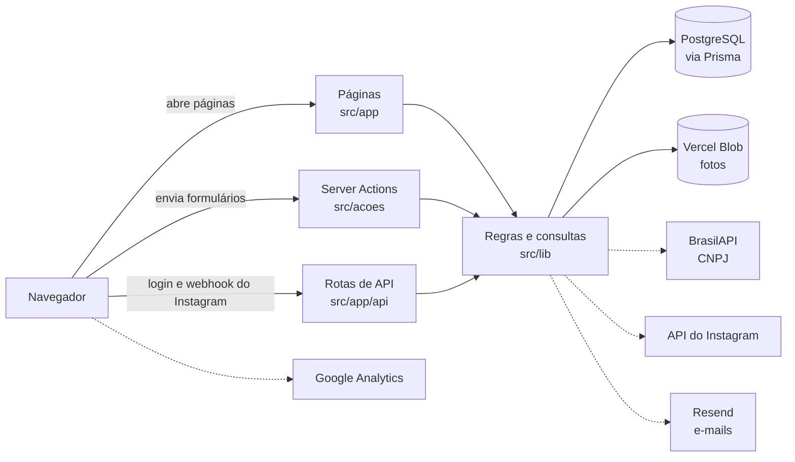
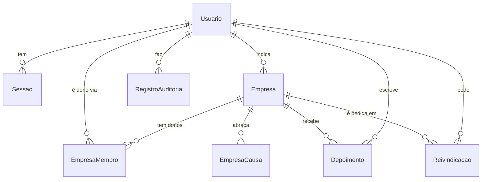

# Como o projeto foi feito

Este guia conta o raciocínio por trás do Negócio do Bem: o propósito, os princípios que guiaram cada decisão, a ordem em que as coisas foram construídas, como o código está organizado e como mexer nele com segurança.

As regras em si, uma por uma, estão em [Regras de negócio](regras-de-negocio.md). Para rodar o projeto, veja o [README](../README.md#rodando-localmente). Para abrir um pull request, veja o [CONTRIBUTING](../CONTRIBUTING.md).

## Sumário

1. [Por que o projeto existe](#1-por-que-o-projeto-existe)
2. [Os princípios por trás das decisões](#2-os-princípios-por-trás-das-decisões)
3. [Como o projeto foi construído, passo a passo](#3-como-o-projeto-foi-construído-passo-a-passo)
4. [Arquitetura](#4-arquitetura)
5. [Padrões do código](#5-padrões-do-código)
6. [Testes](#6-testes)
7. [Publicação e infraestrutura](#7-publicação-e-infraestrutura)
8. [Receitas para mudanças comuns](#8-receitas-para-mudanças-comuns)
9. [Armadilhas conhecidas](#9-armadilhas-conhecidas)
10. [Como trabalhamos](#10-como-trabalhamos)

---

## 1. Por que o projeto existe

O Negócio do Bem nasceu para dar visibilidade a quem cuida das pessoas, da comunidade e do planeta. A página [Como funciona](https://negociodobem.vercel.app/sobre) resume a ideia: quando negócios são atacados por defenderem o respeito e a dignidade, a melhor resposta é coletiva. A comunidade encontra, indica e fortalece quem faz o bem.

Daí saem as três peças do produto:

- **Um diretório** onde as pessoas encontram negócios pelas causas que importam para elas (escala 5x2, antirracista, pet friendly, liderado por mulheres…), pela cidade e pelo estado.
- **A voz da comunidade:** qualquer pessoa indica um negócio e deixa depoimentos.
- **A voz do dono:** quem cuida do negócio assume o perfil e conta a própria história.

## 2. Os princípios por trás das decisões

Quase toda regra do sistema sai de um destes princípios. Diante de uma decisão nova, comece por eles.

### A comunidade indica, o dono confirma, a moderação garante

O diretório cresce sem precisar que os donos se cadastrem primeiro: qualquer pessoa indica. Isso traz um risco, que é alguém se passar pelo dono ou cadastrar um perfil falso. A resposta tem três partes:

- **A moderação corrige depois.** Indicações entram no ar na hora, e a moderação tira do ar o que for spam ou perfil falso. Até a [issue #20](https://github.com/fabsreis/Negocio-do-bem/issues/20), cada indicação esperava a revisão, mas a fila cresceu mais rápido do que dava para revisar.
- **O selo diz quem falou.** "Indicado pela comunidade" e "Verificado pelo dono" são selos diferentes, então quem visita sabe se o perfil foi confirmado.
- **Quem chega primeiro num negócio sem dono vira dono.** O pedido pelos dados do negócio é aprovado na hora quando ninguém assumiu o perfil. Disputas, quando o negócio já tem dono, continuam com a moderação.

### O @ do Instagram é a identidade do negócio

Cada negócio é o seu @: ele é único, é o endereço da página (`/empresas/<@>`) e é o que a moderação abre para comparar com os dados enviados.

- **Por que o @:** é público, fácil de achar e de digitar, e quem indica normalmente já sabe qual é.
- **Por que só o @ não basta:** um @ pode ser abandonado e registrado por outra pessoa. Por isso, nos caminhos de verificação pelo Instagram, o perfil fica ligado ao **ID fixo da conta**, e uma conta diferente da registrada nunca é aprovada sozinha.

### Na dúvida, uma pessoa decide

- **Quando a máquina aprova sozinha:**
  - no pedido pelos dados do negócio, quando o negócio não tem dono e está no ar;
  - nos caminhos pelo Instagram, quando não há nenhum conflito.
- **Quando uma pessoa decide:** em qualquer situação estranha. O negócio já tem dono, foi tirado do ar, o @ trocou de conta, ou a conta está ligada a outro perfil.
- **O que a pessoa da moderação recebe:** uma anotação explicando o que aconteceu, e a escolha entre adicionar como co-dono ou transferir.
- **O que fica registrado:** toda decisão vai para a auditoria.

### A confiança da comunidade vem antes do controle do dono

- **O dono responde, mas não apaga depoimentos.**
- **Denunciar não esconde o depoimento.** Só a moderação remove, e a decisão fica registrada.

Assim, um depoimento negativo e honesto não some só porque incomodou o dono, e um depoimento ofensivo tem um caminho claro para sair.

### Privacidade por padrão

- **Dados mínimos:** da conta, só nome e e-mail.
- **Nada de raspagem:** o site não raspa o Instagram.
- **Nada de tokens guardados:** o login com Instagram só serve para provar quem controla a conta.
- **Só imagens próprias:** o site só mostra fotos que ele mesmo guardou, porque uma imagem de outro endereço avisaria aquele servidor a cada visita.
- **Direito de não aparecer:** o dono oculta o negócio a qualquer momento. É a resposta para quem foi indicado e não quer estar no diretório.

### Sem ranking e sem anúncio pago

A ordem do diretório é simples e transparente: verificados primeiro, depois os atualizados mais recentemente. Não existe nota, destaque pago nem algoritmo de relevância.

### Funcionar sem depender de terceiros

O site precisa funcionar mesmo quando um serviço de fora falha ou ainda não foi configurado:

| Serviço | Sem ele, o site… |
| --- | --- |
| Integração com o Instagram | Funciona: a reivindicação pelos dados do negócio continua disponível. |
| Consulta de CNPJ (BrasilAPI) | Funciona: a consulta é só um apoio para a moderação, nunca bloqueia a análise. |
| Google Analytics | Funciona: sem o ID, ele simplesmente não carrega. |
| Vercel Blob | Funciona. No computador de quem desenvolve, as fotos ficam numa pasta local. Em produção, só o envio de fotos mostra um erro. |
| Envio de e-mails (Resend) | Funciona, com uma exceção: ninguém recebe os avisos nem os links. Quem tem senha continua entrando. Com a confirmação de e-mail ligada, uma conta nova não consegue confirmar o e-mail e, até o envio voltar, não indica, não escreve depoimentos e não reivindica. |

### Tudo em português

Código, nomes de tabelas, rotas, mensagens e documentação estão em português do Brasil (`empresa`, `reivindicacao`, `depoimento`, `causas`, `exigirModerador`). O público é brasileiro, e quem colabora lê o código na mesma língua do produto.

---

## 3. Como o projeto foi construído, passo a passo

O projeto foi construído em outubro de 2026, com a ajuda do [Claude Code](https://claude.com/claude-code). O `AGENTS.md` e o `CLAUDE.md` guiam os agentes de IA que trabalham no repositório. O histórico do Git e os pull requests contam os detalhes.

### 28 de outubro: a primeira versão

A primeira versão já trouxe o produto completo:

- o diretório com busca e filtros;
- os perfis com história em Markdown;
- a indicação pela comunidade;
- o painel do dono;
- a moderação com filas, transferência em disputas e auditoria;
- os testes de banco para as regras de reivindicação.

A reivindicação nasceu com **três caminhos**:

| Caminho | Como funciona |
| --- | --- |
| **Entrar com Instagram** | Na hora: o Instagram confirma qual conta a pessoa controla. |
| **Código por DM** | A pessoa manda um código a partir do @ do negócio para o perfil oficial do projeto. |
| **Dados do negócio** | A moderação confere CNPJ e contato. |

Logo depois, o Postgres do Docker passou para a porta **5433**, para não brigar com um Postgres já instalado no computador.

### 28 de outubro: a reivindicação fica simples ([#2](https://github.com/fabsreis/Negocio-do-bem/pull/2))

Os dois caminhos pelo Instagram dependem da Meta:

- um app aprovado na revisão da Meta;
- a verificação do negócio;
- um perfil oficial definido;
- um token que vence e precisa ser renovado.

Para colocar o projeto no ar sem esperar tudo isso, a reivindicação passou a ter **um caminho só**: a pessoa envia os dados do negócio (CNPJ ou MEI, site, relação com o negócio e contato) e a moderação confere com o @ do Instagram.

**Nada foi apagado.** O código, as rotas e os testes dos caminhos pelo Instagram continuam no projeto e ligam sozinhos quando as variáveis de ambiente são preenchidas.

No mesmo dia, o README ganhou os prints das telas ([#1](https://github.com/fabsreis/Negocio-do-bem/pull/1)).

### 29 de outubro: código aberto e no ar ([#3](https://github.com/fabsreis/Negocio-do-bem/pull/3))

O repositório virou código aberto:

- licença MIT;
- `CONTRIBUTING.md` e `SECURITY.md`;
- verificações automáticas em todo PR;
- a branch principal renomeada para `main`.

O site passou a dizer, no rodapé e em "Como funciona", que o código é aberto, porque transparência sobre como os dados são tratados faz parte da proposta.

No mesmo PR, o site foi publicado no Vercel. O banco é um Postgres no Neon, e as migrações rodam a cada deploy de produção (`scripts/vercel-build.sh`). As funções ficam em São Paulo (`gru1`), perto do banco e do público.

### 29 de outubro: foto, contatos e história com fotos ([#4](https://github.com/fabsreis/Negocio-do-bem/pull/4))

Primeiro pedido depois do lançamento: o perfil precisava de mais vida e de mais formas de contato.

- **Foto do perfil:**
  - o navegador reduz a foto antes de enviar;
  - o servidor confere o tipo pelos primeiros bytes;
  - ela fica guardada no Vercel Blob.
- **Contatos:** WhatsApp, e-mail e site viram botões no perfil.
- **História com fotos e legendas.**

A ideia de puxar a foto direto do Instagram ficou para depois, porque só funciona pela API oficial e com contas comerciais.

### 29 de outubro: issues e pull requests ([#6](https://github.com/fabsreis/Negocio-do-bem/pull/6))

O projeto adotou o fluxo descrito em [Como trabalhamos](#10-como-trabalhamos): issue antes do código, branch por issue, PR com revisão e deploy só pelo merge. A `main` ficou protegida.

### 29 de outubro: a moderação edita qualquer perfil ([#9](https://github.com/fabsreis/Negocio-do-bem/pull/9))

A moderação precisava corrigir um telefone ou trocar a foto de qualquer negócio, sem depender do dono.

- **Uma tela só, para dono e moderação.** A moderação usa o mesmo formulário do dono (`EdicaoEmpresa`), aberto pelo painel de moderação. Assim, uma melhoria no formulário vale para os dois.
- **Rastro na auditoria.** Cada edição da moderação ganha o sufixo `_pela_moderacao`.
- **Ocultar continua só do dono.**

### 29 de outubro: a história no estilo Substack ([#10](https://github.com/fabsreis/Negocio-do-bem/pull/10))

O campo de Markdown virou um editor visual (Tiptap), com títulos, citações, listas, separadores e fotos com legenda.

A decisão importante: **a história continua guardada em Markdown.** Por isso:

- as histórias antigas abrem sem migração;
- o perfil continua usando o mesmo componente seguro de exibição;
- em troca, o editor só oferece o que o Markdown guarda (nada de sublinhado ou cores).

### 29 de outubro: modo escuro ([#12](https://github.com/fabsreis/Negocio-do-bem/pull/12))

O switch no cabeçalho alterna entre claro e escuro.

- **Na primeira visita,** o site segue o sistema da pessoa. Depois, a escolha fica salva no navegador.
- **Sem piscar:** um script no `<head>` aplica o tema antes da primeira pintura.
- **As cores são variáveis do tema.** As classes não mudam: o que muda é o valor de cada cor.

### 29 de outubro: Google Analytics ([#14](https://github.com/fabsreis/Negocio-do-bem/pull/14))

O objetivo era medir o tráfego do site.

- **Só em produção:** o Analytics carrega apenas quando `NEXT_PUBLIC_GA_ID` existe, e ela só está configurada em Production. Cópias do projeto e previews não mandam dados.
- **Sem aviso de cookies:** foi uma decisão do projeto. A seção de privacidade de "Como funciona" explica a medição.

### 29 de outubro: aprovação automática ([#20](https://github.com/fabsreis/Negocio-do-bem/issues/20))

No primeiro dia no ar, a fila da moderação chegou a 16 reivindicações e 20 indicações, e aprovar uma por uma virou gargalo. A decisão foi trocar "aprovar antes" por "corrigir depois":

- **Indicações** entram no ar na hora. A aba Negócios da moderação ganhou "Tirar do ar" e "Publicar de novo", que não existiam.
- **Reivindicações pelos dados do negócio** são aprovadas na hora quando o negócio não tem dono e está no ar. Disputas continuam com a moderação.
- **A fila antiga** se esvazia com dois botões: "Publicar todas" e "Aprovar os N pedidos sem dono".
- **A consulta à Receita** voltou a funcionar ([#21](https://github.com/fabsreis/Negocio-do-bem/issues/21)). A BrasilAPI recusava o User-Agent padrão do `fetch` do Node e respondia 403.
- **O risco aceito:** qualquer conta assume um perfil que ainda não tem dono. Uma verificação de verdade fica como próximo passo. Por exemplo, comparar o nome de quem pede com os sócios que a Receita devolve para o CNPJ.

### 29 de outubro: homologação na `stage` ([#23](https://github.com/fabsreis/Negocio-do-bem/issues/23))

Até aqui, o merge de um PR já publicava em produção. Para ter uma etapa de homologação entre o código revisado e o site no ar:

- **A `stage` virou a branch padrão.** Os PRs do dia a dia vão para ela, e o preview dela no Vercel mostra o que vai para produção.
- **Publicar é um PR da `stage` para a `main`.**
- **Um ruleset protege `main`, `stage` e `releases/**`:** PR com 1 aprovação, a checagem "Lint, tipos e testes", só squash e histórico linear, sem force push e sem apagar a branch. Quem administra o repositório pode fazer o merge do próprio PR sem esperar aprovação, mas não pode dar push direto.

### 29 de outubro: fotos de perfil pelo Instagram ([#31](https://github.com/fabsreis/Negocio-do-bem/issues/31))

Muitos negócios ficavam sem foto até o dono entrar. A ideia era buscar a foto de perfil no Instagram, sem pesar no Vercel.

- **Coleta direta, não.** Buscar a foto por endereços internos do Instagram vai contra os termos da Meta e costuma ser bloqueada. Foi descartada.
- **API oficial, sim.** A Business Discovery devolve a foto de contas comerciais ou de criador em 1080×1080. Ela só existe no login pelo Facebook (`graph.facebook.com`), não no login pelo Instagram. Por isso o app "Negócio do Bem" da Meta é separado do ComentAI, e a conta que consulta (@ofabsreis) precisa estar ligada a uma Página do Facebook.
- **O trabalho pesado fica num computador.** O script `scripts/fotos-instagram.ts` roda todo dia pelo launchd do macOS: busca, recorta e converte a foto, e envia pronta. O Vercel só confere e grava, por uma rota protegida por `FOTOS_TOKEN`.
- **A foto do dono vence sempre.** A rotina só preenche negócio sem foto, e a gravação confere isso de novo no último instante.
- **Pasta manual de reforço:** uma foto em `fotos-manuais/<@>.jpg` tem prioridade, para as contas que a API não alcança.

### 29 de outubro: o Blob pelo OIDC, sem token ([#30](https://github.com/fabsreis/Negocio-do-bem/issues/30))

O painel do Vercel recomendou revogar o token de leitura e escrita do Blob de produção, porque o projeto já se autentica pelo OIDC do deploy. O `@vercel/blob` já preferia o OIDC com o `BLOB_STORE_ID`, mas o site só usava o Blob quando a `BLOB_READ_WRITE_TOKEN` existia.

- **O site usa o Blob com `BLOB_STORE_ID` ou `BLOB_READ_WRITE_TOKEN`** (`src/lib/armazenamento.ts`). Sem nenhuma das duas, continua a pasta local em desenvolvimento e o erro em produção.
- **Com a mudança em produção, o token do Blob de produção é revogado** no painel (página **Projects** do Blob). Ele também estava guardado nos deploys de preview antigos, de antes do Blob dos previews. Revogar tira esse acesso de vez.

### 29 de outubro: a publicação entra por merge commit ([#50](https://github.com/fabsreis/Negocio-do-bem/issues/50))

O PR de publicação [#46](https://github.com/fabsreis/Negocio-do-bem/pull/46) conflitou, mesmo com a `main` contida na `stage`. Com squash nas duas branches, a base comum da `stage` e da `main` não avançava: cada publicação criava na `main` um commit novo, que a `stage` não tinha. Quando a `stage` mudava linhas perto do que já tinha sido publicado, o Git via duas mudanças diferentes no mesmo trecho.

- **A `main` aceita só merge commit.** O ruleset único virou dois. O da `stage` (e de `releases/**`) continua só com squash e histórico linear. O da `main` aceita só merge commit e não exige histórico linear. Depois de cada publicação, a ponta da `stage` passa a fazer parte da história da `main`, e o próximo PR mostra só o que ainda falta publicar.
- **Por que não as outras saídas.**
  - Um PR da `main` de volta para a `stage` depois de cada publicação não resolve: o squash na `stage` não registra a `main` como pai, e a base comum continua parada.
  - A saída usada no [#48](https://github.com/fabsreis/Negocio-do-bem/pull/48), um branch com a `stage` mais um merge da `main`, funciona. Só que precisaria se repetir a cada conflito, e os conflitos ficariam mais frequentes, porque a distância entre a base comum e a `main` só cresce.
- **A aprovação ficou só na `main`.** O projeto tem uma pessoa com acesso de escrita, e o GitHub não deixa aprovar o próprio PR. Com 1 aprovação exigida nas duas branches, todo merge dependia do bypass, e o auto-merge nunca disparava. Agora a `stage` não exige aprovação, e os PRs do dia a dia entram com o botão normal, depois da checagem. A `main` continua exigindo 1 aprovação, para publicar em produção ser um passo consciente. Quando o projeto tiver outra pessoa mantenedora, a aprovação volta para a `stage`.
- **A primeira vez:** a base comum ainda era `12f1e87`, de antes da `stage`. Um PR sem nenhuma mudança de arquivo ([#52](https://github.com/fabsreis/Negocio-do-bem/pull/52)), com a `stage` mais um merge da `main`, entrou na `main` por merge commit e fez a base comum avançar até a `stage`.
- **O custo:** a `main` deixa de ter histórico linear. `git log --first-parent main` mostra uma linha por publicação.

### 29 de outubro: cidades da lista do IBGE ([#35](https://github.com/fabsreis/Negocio-do-bem/issues/35))

A cidade era digitada à mão, com o estado num seletor à parte. A mesma cidade aparecia escrita de jeitos diferentes ("Sao Paulo", "são paulo"), o que atrapalha a busca e a contagem por cidade.

- **A lista fica no projeto.** `src/lib/municipios.json` tem os municípios do IBGE, e `npm run municipios:atualizar` baixa de novo. Nada de consultar uma API a cada acesso, para o site não depender de terceiros.
- **Cidade e UF viraram um campo só,** que sugere cidades enquanto a pessoa digita e envia "Recife, PE". O banco continua com as duas colunas.
- **A lista só é baixada quando alguém mexe no campo.** O `CampoMunicipio` carrega `src/lib/municipios.ts` com `import()`, e os cerca de 110 KB não pesam nas outras páginas.
- **O servidor confere na mesma lista** e grava o nome oficial, com acentos. O campo funciona sem JavaScript: "Recife, PE" digitado à mão também vale.

### 29 de outubro: página inicial nova e diretório com filtros ([#39](https://github.com/fabsreis/Negocio-do-bem/issues/39))

A página inicial juntava apresentação, busca, filtros de causas e a lista de negócios, e achar um negócio era confuso. Três variações foram desenhadas num protótipo. A escolhida juntou a página inicial de uma com o diretório de outra.

- **A página inicial ficou para começar:** o número de negócios cadastrados em destaque, a busca "O que você procura?" + "Onde?", atalhos e os tipos de negócio com seus totais.
- **O diretório ganhou endereço próprio, `/explorar`.** Ele abre ao buscar ou ao escolher um tipo, com os filtros ao lado (tipo, causas, só verificados), grade ou lista e paginação numerada.
- **Os filtros são links, não um formulário.** Cada opção é um link para a URL com aquele filtro trocado (`mudarFiltro`, em `src/lib/diretorio.ts`). Assim funciona sem JavaScript e toda busca pode ser compartilhada. Só a ordenação usa um `<select>` com JavaScript.
- **Cada opção mostra quantos negócios aparecem ao marcá-la.** São poucas consultas por página: um `groupBy` por categoria ignorando os tipos marcados, e um `groupBy` das causas entre os resultados.
- **O "Onde?" sugere só lugares com negócios** (`listarCidades`). A lista é pequena e vai pronta para o navegador. O texto escolhido ("Recife, PE") vai na URL e o servidor o interpreta, então digitar à mão também funciona.

### 29 de outubro: banco separado para os previews ([#18](https://github.com/fabsreis/Negocio-do-bem/issues/18))

Os previews do Vercel, inclusive o da `stage`, usavam o banco de produção. Testar a homologação mexia em dados reais, e um bug num PR podia apagá-los.

- **Os previews ganharam um projeto Neon só deles**, conectado ao Vercel apenas no ambiente Preview. O de produção ficou só em Production.
- **O build dos previews passou a aplicar as migrações** no banco deles. Um PR que muda o banco já funciona no preview.
- **O seed roda no build dos previews**, para a homologação ter dados de exemplo, e só preenche um banco vazio.

### 29 de outubro: um Blob só para os previews ([#27](https://github.com/fabsreis/Negocio-do-bem/issues/27))

Os previews também usavam o Vercel Blob de produção, onde ficam as fotos. Então o código de um PR podia gravar e apagar as fotos reais.

- **O Preview ganhou um Blob público próprio,** e o de produção ficou só em Production. As credenciais de cada ambiente, o token e o OIDC do deploy, só alcançam o Blob dele.
- **O código não precisou mudar.** O site aceita fotos de qualquer store do Vercel Blob (`ehFotoDoSite`), então as fotos enviadas num preview aparecem no próprio preview. Um teste garante isso.

### 29 de outubro: nova identidade visual e SEO ([#62](https://github.com/fabsreis/Negocio-do-bem/issues/62), [#63](https://github.com/fabsreis/Negocio-do-bem/issues/63))

O site ganhou o logo novo, com três pessoas formando um coração, e passou a se apresentar direito para o Google, o Bing e os assistentes que buscam na web.

- **Um desenho só para tudo.** `src/lib/marca.ts` guarda o ícone e o texto do logo. Dele saem o `Logo` do cabeçalho e do rodapé, os ícones (`npm run marca:icones`) e as imagens de compartilhamento.
- **O texto do logo foi vetorizado do PNG.** O SVG exportado do manual trazia o texto como fonte (Casko Luxury), sem curvas, e o "em" de "Bem" saía vazio. Quando chegar um SVG com o texto em curvas, basta trocar `TEXTO_DO_LOGO`.
- **Cores da marca fixas.** `marca-laranja`, `marca-verde`, `marca-marrom` e `marca-creme` não mudam no modo escuro. No escuro, o logo troca o marrom pelo creme, como na versão do manual para fundo escuro. As cores do tema passaram a partir delas: o creme é o papel, e o marrom é a tinta.
- **Prévia de link com a marca.** `opengraph-image.tsx` gera a imagem geral no build, e cada perfil tem a sua, com foto, nome, cidade e causas. As fontes ficam em `assets/fontes`, porque o gerador não lê woff2 nem fonte variável.
- **SEO:**
  - `metadataBase`, canônico e Open Graph em cada página pública;
  - sitemap com os negócios do diretório e `robots.txt`;
  - dados estruturados: `Organization` e `WebSite` na página inicial, `LocalBusiness` e `BreadcrumbList` no perfil;
  - `noindex` nas páginas de conta;
  - um `llms.txt` para assistentes de IA.

  O título do perfil traz o tipo e a cidade, que é o que as pessoas buscam.
- **Um endereço só.** Os links absolutos usam o domínio de produção (`VERCEL_PROJECT_PRODUCTION_URL`) até nos previews, e os previews bloqueiam os robôs.

### 29 de outubro: páginas de cidade, causa e tipo ([#71](https://github.com/fabsreis/Negocio-do-bem/issues/71))

O diretório filtra pela URL, e o canônico de `/explorar` ignora os filtros, para as combinações não virarem milhares de páginas parecidas na busca. Faltavam páginas para responder às buscas mais comuns: "negócios do bem em Salvador", "negócios liderados por mulheres", "café e padaria".

- **Três páginas fixas:** `/cidades/salvador-ba` (e o índice `/cidades`), `/causas/opcoes-veganas` e `/tipos/cafe-e-padaria`. Cada uma tem título, descrição, canônico e JSON-LD próprios (`CollectionPage`, `ItemList` e `BreadcrumbList`).
- **Reaproveitam o diretório.** A lista vem de `buscarDiretorio` com um filtro só, então a página da cidade segue as mesmas regras do "Onde?", inclusive a junção das grafias. O componente `Vitrine` monta as três.
- **Porta de entrada, não substituto.** Os filtros continuam no `/explorar`: as páginas mostram os 18 primeiros e levam ao diretório com o filtro marcado.
- **Ligadas por dentro.** O perfil liga tipo, cidade e causas às suas páginas, e o caminho dele no JSON-LD passa pela cidade. A página inicial, "Como funciona", o rodapé, o sitemap e o `llms.txt` também apontam para elas.
- **Sem página vazia na busca.** Cidade sem negócios mostra a página de não encontrado, e causa ou tipo sem negócios leva `noindex` e fica fora do sitemap.

### 29 de outubro: a mesma cidade com grafias diferentes ([#56](https://github.com/fabsreis/Negocio-do-bem/issues/56))

O "Onde?" mostrava "São Paulo · 43 negócios", mas escolher a cidade trazia 1 só. E Florianópolis aparecia duas vezes, com e sem acento. Os cadastros de antes da lista do IBGE gravaram a cidade como foi digitada, e o diretório tratava cada grafia como uma cidade. Ao escolher "São Paulo, SP", o servidor pegava a primeira grafia que batia sem acento ("Sao Paulo") e filtrava só por ela.

- **`listarCidades` junta as grafias** de cada cidade e UF e mostra o nome oficial (`nomeOficial`, em `src/lib/municipios.ts`). Acentos, maiúsculas, hífen e apóstrofo não importam, e a UF grudada no nome ("Tubarão-SC") sai. A lista do IBGE não tem duas cidades no mesmo estado que só mudem nesses detalhes.
- **O filtro procura todas as grafias** que estão no banco (`condicaoDoLocal`, em `src/lib/consultas.ts`). Assim a contagem do "Onde?" bate com os resultados, mesmo que um nome fora do padrão volte a entrar.
- **`npm run cidades:corrigir` arruma o banco,** para o perfil e os cartões também mostrarem o nome oficial. Ele grava direto no SQL, para não mudar o `atualizadoEm`, que ordena o diretório, e refaz o campo `busca`.
- **As páginas de cidade usam o mesmo nome oficial.** O endereço (`/cidades/sao-paulo-sp`), as cidades de uma causa ou de um tipo (`cidadesCom`) e os links do perfil e do sitemap juntam as grafias. Assim, um negócio gravado como "Tubarão-SC" leva à página de Tubarão, SC.

### 29 de outubro: painel da moderação ([#75](https://github.com/fabsreis/Negocio-do-bem/issues/75))

A moderação via as filas, os 50 negócios atualizados por último e os 100 últimos registros da auditoria. Não dava para ver as contas, os números do projeto nem tudo o que uma pessoa fez no site.

- **Um painel, não um sistema novo.** O `/moderacao` ganhou um menu lateral com a visão geral, as filas que já existiam, os cadastros (negócios, contas e depoimentos) e os registros (auditoria e sistema). Os endereços antigos (`?aba=reivindicacoes` e os outros) continuam valendo.
- **Só consulta.** As ações continuam as mesmas. Dar moderação, suspender ou apagar uma conta mudam regras de permissão e de privacidade e ficaram para issues próprias.
- **Números do banco, não de um serviço de métricas.** A visão geral conta direto no Postgres, a cada abertura, sem `use cache`. Os agrupamentos (`groupBy`) somam várias situações numa consulta só.
- **Semanas de 7 dias corridos até agora.** A atividade não usa a semana do calendário: assim nenhuma semana fica pela metade e o fuso horário não muda a conta. O agrupamento (`agruparPorSemana`) é uma função pura, com teste.
- **A ficha não lê a senha.** As consultas de contas usam sempre `select`, e um teste confere que o hash não vem junto.
- **O que a URL traz é conferido.** Aba, situação, página, ação, pessoa e alvo passam por `lerFiltros`, como os filtros do diretório. O "Tirar do ar" volta para a lista filtrada de onde saiu, mas só aceita um endereço da própria moderação.

### 29 de outubro: avisos por e-mail ([#83](https://github.com/fabsreis/Negocio-do-bem/issues/83))

Ninguém recebia e-mail do site. Quem pedia um perfil que já tinha dono só descobria a decisão abrindo o painel, e a moderação só via pedidos e denúncias novos abrindo as filas.

- **Resend, pela API.** O plano gratuito (100 e-mails por dia, 3.000 por mês) dá conta dos avisos. A chamada é um `fetch` em `src/lib/email.ts`, sem pacote novo. O Zoho Mail, que guarda a caixa `ola@negociodobem.com`, desaconselha a conta gratuita para e-mails automáticos, e SMTP é lento numa função do Vercel.
- **Dois serviços no mesmo domínio.** O Resend envia com registros próprios (`resend._domainkey` e o subdomínio `send`), e o MX e o SPF da raiz continuam com o Zoho. As respostas aos avisos vão para `ola@negociodobem.com` (`EMAIL_RESPOSTA`).
- **Poucos avisos, para quem precisa agir.** A decisão da moderação vai para quem pediu, pedidos e denúncias novos vão para a moderação, e depoimentos novos vão para os donos. A aprovação na hora não manda e-mail: a pessoa já está vendo o resultado.
- **Depois da resposta.** As ações chamam os avisos dentro de `after()`. A pessoa não espera o Resend, e uma falha no envio só fica no log.
- **Privacidade.** Cada pessoa recebe o próprio e-mail, e o aviso para a moderação leva só o negócio e o link da fila.
- **Só a produção envia.** Nos previews o envio fica desligado mesmo com as variáveis. O banco deles só tem contas de teste, e mandar e-mail para elas só traria devoluções.

### 29 de outubro: e-mail confirmado e entrar por link ([#124](https://github.com/fabsreis/Negocio-do-bem/issues/124))

O cadastro aceitava qualquer e-mail. Uma conta com o e-mail de outra pessoa, ou com um endereço inventado, indicava negócios, escrevia e denunciava depoimentos e reivindicava perfis.

- **Uma estrutura só para os links.** A tabela `LinkEmail` guarda o sha256 do token, a finalidade (`confirmar` ou `entrar`), o e-mail, o destino, o prazo e o uso. A confirmação e o "Entrar por link" usam a mesma tabela, e a recuperação de senha ([#65](https://github.com/fabsreis/Negocio-do-bem/issues/65)) pode usar também.
- **Entrar primeiro, confirmar depois.** A conta entra no site logo no cadastro e só precisa do e-mail confirmado para o que fala em nome dela para a comunidade: indicar, escrever e denunciar depoimentos e reivindicar. Bloquear o login até a confirmação faria perder quem só queria olhar o painel.
- **Um clique, não só abrir.** Antivírus e filtros como o do Outlook abrem os links dos e-mails sozinhos. Se abrir o link bastasse, esses filtros gastariam o link de entrar e confirmariam o e-mail de uma conta que outra pessoa criou com aquele endereço. Por isso `/api/link` só guarda o token num cookie e `/link` pede o clique.
- **O token fora do endereço da página.** O Google Analytics registra o endereço de cada página. Com o token no cookie, `/link` não tem nada de secreto no endereço.
- **A senha continua.** O link por e-mail não é mais seguro que a senha: quem abre a caixa de e-mail entra na conta, o que a recuperação de senha também vai permitir. Ele tira a senha repetida e a força bruta do caminho de quem prefere não usar senha. O segundo fator para a moderação fica para a [#103](https://github.com/fabsreis/Negocio-do-bem/issues/103).
- **Limite por conta, não por IP.** Cinco links por conta a cada hora impedem lotar a caixa de alguém e gastar a cota de 100 e-mails por dia do Resend com uma conta só. O limite por IP do login fica com a [#36](https://github.com/fabsreis/Negocio-do-bem/issues/36).

### 30 de outubro: robôs fora dos filtros do /explorar ([#141](https://github.com/fabsreis/Negocio-do-bem/issues/141))

Na manhã de 30 de outubro, a página inicial, o `/explorar`, o `/cidades` e o sitemap pararam de abrir em produção. O Neon tinha pausado o banco por estourar o plano grátis: 6,85 GB de transferência em um dia e meio, para um limite de 5 GB por mês.

- **A causa foi um robô.** Em 24 horas o site recebeu 626 mil requisições, 162 mil delas do GPTBot, quase todas no `/explorar`. Cada filtro é um link, os filtros se combinam (tipo, causa, verificados, ordem, vista e página) e o robô abria cada combinação. Cada abertura faz seis consultas ao banco.
- **O banco voltou com o plano Launch do Neon**, pago por uso. O compute de produção ficou fixo em 0,25 CU: no pior caso, ligado o mês inteiro, custa cerca de US$ 19. Ele continua desligando depois de 5 minutos sem uso.
- **O `robots.txt` bloqueia `/explorar?...`, e os links dos filtros levam `nofollow`.** O `/explorar` sem filtros, as páginas de cidade, causa e tipo e o sitemap continuam abertos, e o diretório segue chegando à busca e aos assistentes. As combinações já tinham o `/explorar` como canônico e não entravam na busca.

### 30 de outubro: confirmação de e-mail desligada por enquanto ([#148](https://github.com/fabsreis/Negocio-do-bem/issues/148))

No mesmo dia, o site passou dos 100 e-mails por dia do plano grátis do Resend. Daí em diante o link de confirmação não chegava, e quem se cadastrava ficava sem poder indicar, escrever depoimentos ou reivindicar.

- **Uma constante, não uma variável de ambiente.** `CONFIRMACAO_DE_EMAIL_LIGADA`, em `src/lib/auth/links.ts`, desliga a exigência. Trocar uma variável no Vercel pediria um redeploy fora do fluxo de merge, e a volta da confirmação deve vir no mesmo PR que trocar o envio de e-mails.
- **Desligar num lugar só.** `usuarioAtual` devolve `emailConfirmado: true` para toda conta, e as travas, o "Confirme seu e-mail" e a rota do Instagram continuam olhando o mesmo campo. Nada delas saiu do código.
- **O cadastro não manda o link.** Assim a cota fica para o "Entrar por link" e para os avisos. Quem já recebeu um link ainda pode usá-lo, e `emailConfirmadoEm` continua sendo gravado, então a ficha da moderação mostra quem de fato confirmou.

---

## 4. Arquitetura

### A stack e por que cada peça

| Peça | Versão | Por quê |
| --- | --- | --- |
| **Next.js** (App Router, Cache Components) | 16.4 | Páginas renderizadas no servidor e Server Actions para os formulários: os formulários funcionam até antes do JavaScript carregar, e a permissão é conferida no servidor. |
| **React** | 19 | `useActionState` para os formulários e `useSyncExternalStore` para o tema. |
| **PostgreSQL + Prisma** | Prisma 7 | Banco relacional para dados com relações e regras de unicidade (um @ por negócio, um depoimento por pessoa). O Prisma dá tipos e migrações versionadas. |
| **Zod** | 4 | Validação de cada formulário no servidor, com mensagens em português. |
| **Tailwind CSS** | 4 | Estilo com variáveis de tema (`@theme`), o que permite o modo escuro sem trocar classes. |
| **Tiptap** | 3.31 | Editor visual da história, com leitura e gravação em Markdown. |
| **react-markdown + remark-gfm** | 10 | Exibição da história sem executar HTML. |
| **Vercel Blob** | 2.8 | Armazenamento das fotos em produção. |
| **Vitest** | 5 | Testes de unidade e de banco. |

A autenticação é feita no próprio projeto (`src/lib/auth/`), com e-mail, senha (scrypt), link por e-mail e sessão em cookie. Isso evita depender de um serviço externo para algo simples.

O scrypt que protege as senhas custa ~32 MB de memória por conferência, então login e cadastro têm limite de tentativas por IP e por e-mail, conferido antes dele (`src/lib/auth/tentativas.ts`). A contagem fica numa tabela do Postgres (`TentativaAcesso`), e não na memória, porque no Vercel o site roda em várias instâncias. Cada tentativa é somada num `INSERT ... ON CONFLICT DO UPDATE` só, que também abre a janela nova quando a anterior venceu: assim, tentativas simultâneas não zeram a contagem umas das outras. Um serviço próprio para contadores (Upstash, Vercel KV) traria mais uma dependência e mais uma variável.

O limite por IP só vale se o IP for de verdade. Fora do Vercel, o `x-forwarded-for` e o `x-real-ip` podem ser escritos por qualquer visitante: se o site confiasse neles, cada tentativa traria um IP novo, e o limite nunca agiria (além de dar para gastar a cota de outra pessoa). Por isso `ipDoCabecalho` (`src/lib/auth/tentativas.ts`) lê só o `x-vercel-forwarded-for` no Vercel (`VERCEL=1`), que o Vercel escreve e o visitante não consegue trocar. Em outra hospedagem, ignora todos os cabeçalhos, a menos que quem cuida do site declare `AUTENTICACAO_PROXY_CONFIAVEL=1`. Aí lê o último valor do `x-forwarded-for` e confere que é um IP. Quando não há IP confiável, todas as tentativas dividem um contador só, em vez de passarem sem limite: o cadastro não tem limite por e-mail, então liberar quem não tem IP deixaria o scrypt sem freio. O preço é que, numa hospedagem sem proxy declarado, os visitantes dividem as 10 tentativas por 15 minutos. Quando essa cota acaba, o login mostra "E-mail ou senha incorretos." até para quem digitou a senha certa, e nada aponta a causa. Fica a favor do site e é fácil de corrigir. Em desenvolvimento (`npm run dev`) também vale: 10 tentativas a cada 15 minutos para o computador todo. Para zerar, apague as linhas da tabela `TentativaAcesso`.

O IP passa por `normalizarIp` antes de virar chave do contador. O IPv4 escrito como IPv6 (`::ffff:203.0.113.5`) volta a ser IPv4. Os endereços IPv6 viram o prefixo /64, porque quem recebe uma rede IPv6 escolhe qualquer endereço dela a cada requisição: sem isso, cada endereço abriria um contador novo, e o limite por IP não valeria contra quem tem IPv6. A contrapartida é que uma rede /64 inteira, como a de uma casa, divide uma cota só. Um prefixo maior que /64 (como um /56) ainda tem um contador para cada /64, e o cadastro só tem o limite por IP.

O limite por e-mail também é conferido antes do scrypt. A tentativa é reservada por `reservarTentativaDoEmail`, no mesmo `INSERT ... ON CONFLICT DO UPDATE ... RETURNING`, que soma e devolve a contagem num comando só. Primeiro conferir e depois contar deixaria passar todas as tentativas que chegam juntas, cada uma de um IP, e o limite por IP não impede isso. Também não há transação aberta durante o scrypt: ela prenderia uma conexão e a linha do contador por ~100 ms a cada login. Quando o login dá certo, a contagem do e-mail é apagada.

O contador do e-mail é separado por origem (a chave é o e-mail junto com o IP, ou o /64 no IPv6). Com um contador só por e-mail, quem soubesse o e-mail de alguém poderia errar a senha 5 vezes e deixar a dona da conta 15 minutos sem entrar, e repetir a cada janela. Separando por origem, o bloqueio vale só para quem está errando. O preço é que um ataque espalhado por muitos IPs ganha 5 palpites por IP para o mesmo e-mail, em vez de 5 no total. Cada IP continua limitado a 10 tentativas por janela, somando todos os e-mails. Um passo além, se for preciso, é o "cookie de dispositivo" que a OWASP recomenda: o navegador onde a pessoa já entrou ganha uma marca assinada e não cai no bloqueio que outros causaram, e aí dá para voltar a ter um limite por e-mail para todo o resto.

O e-mail nunca dá permissão, nem depois de confirmado: as contas antigas não confirmaram, e quem se cadastra primeiro com um endereço escolhe o que confirmar. A moderação vem só do `papel` gravado no banco, conferido no servidor a cada requisição, e quem cuida do projeto dá esse papel com `npm run moderacao`. Até outubro de 2026 a variável `ADMIN_EMAILS` também dava moderação, e qualquer pessoa que se cadastrasse com um daqueles e-mails antes do dono levava o acesso.

Toda resposta leva cabeçalhos de segurança (`headers()` no `next.config.ts`):

- **`Content-Security-Policy`:** scripts, estilos, imagens e conexões só do próprio site, do Vercel Blob (`*.public.blob.vercel-storage.com`) e do Google Analytics. Nos previews, também do `vercel.live`, a barra de comentários do Vercel. `frame-ancestors 'none'` impede que outro site embuta as páginas num iframe (clickjacking), e `form-action 'self'` impede formulários de enviar dados para fora.
- **Sem nonce:** a CSP aceita scripts inline (`'unsafe-inline'`), como o script do tema no `layout.tsx` e os do próprio Next. Uma CSP com nonce obriga toda página a ser renderizada a cada acesso e é incompatível com o Partial Prerendering, que o projeto usa com o Cache Components. Ficaríamos sem pré-render e sem cache na CDN.
- **`Strict-Transport-Security`** (2 anos), **`X-Frame-Options: DENY`** (para navegadores antigos), **`X-Content-Type-Options: nosniff`**, **`Referrer-Policy: strict-origin-when-cross-origin`** (sites abertos a partir do perfil não recebem o endereço completo) e **`Permissions-Policy`** (sem câmera, microfone, localização, pagamento, USB nem `browsing-topics`).

Se uma página nova precisar de um script, imagem ou iframe de outro endereço, o endereço entra na política, senão o navegador bloqueia e avisa no console.

### Como uma requisição anda



As linhas tracejadas são serviços opcionais. O site funciona sem eles.

### Onde fica cada coisa

| Pasta | Conteúdo |
| --- | --- |
| `prisma/` | Esquema do banco (`schema.prisma`), migrações e dados de exemplo (`seed.ts`). |
| `src/app/` | Páginas e rotas. Cada pasta é um endereço: `explorar/` é o diretório, `empresas/[usuario]` é o perfil, `painel/` é o painel do dono, `moderacao/` é a moderação, `api/` tem as rotas do Instagram. |
| `src/acoes/` | Server Actions, uma por formulário ou botão. Conferem a permissão e validam os dados. |
| `src/lib/` | Regras de negócio e utilitários, sem interface: `reivindicacao.ts`, `consultas.ts`, `instagram.ts`, `causas.ts`, `cnpj.ts`, `formulario.ts`, `armazenamento.ts`, `auth/`, `moderacao/` (filtros, indicadores e consultas do painel da moderação)… |
| `src/components/` | Componentes de interface reutilizados entre páginas. |
| `tests/` | `unit/` (sem banco) e `db/` (com banco). |
| `docs/` | Esta documentação e os prints do README. |
| `assets/fontes/` | Fontes das imagens de compartilhamento, com a licença OFL de cada uma. |

### O banco



Decisões do esquema:

- **Status como texto, não `enum`,** para o esquema ser simples de evoluir. Os valores aceitos estão comentados no `schema.prisma` e os rótulos em `src/lib/dominio.ts`.
- **Um campo `busca`** guarda nome, resumo, categoria, cidade, UF e @ em minúsculas e sem acento. Ele é atualizado a cada indicação e edição. Assim, a busca sem acento é um `contains` simples, sem extensão no Postgres.
- **As causas ficam no código** (`src/lib/causas.ts`), e o banco guarda só o slug. Criar uma causa é mudar uma linha, sem migração.
- **Unicidade garantida pelo banco:**
  - um @ por negócio;
  - um ID de conta do Instagram por negócio;
  - um depoimento por pessoa por negócio;
  - um código de DM único.
- **O que acontece ao apagar** (não há tela para isso hoje, só direto no banco):
  - **uma conta:** apaga as sessões, os vínculos de dono, os pedidos de reivindicação e os depoimentos dela. Os negócios que ela indicou, as decisões que tomou e os registros de auditoria ficam, sem o autor;
  - **um negócio:** apaga as causas, os donos, os depoimentos e os pedidos ligados a ele.

---

## 5. Padrões do código

Siga estes padrões numa mudança nova. Eles estão em todo o projeto.

### Server Actions

Cada formulário chama uma função em `src/acoes/`, sempre na mesma ordem:

1. **Confere quem está pedindo,** com uma destas funções:
   - `exigirUsuario` (precisa de login);
   - `exigirDono` (precisa ser dono);
   - `exigirEditor` (dono ou moderação);
   - `exigirModerador` (moderação, senão 404).

   Nunca confie em um botão escondido: a conferência é sempre no servidor.
2. **Valida os dados com Zod.** Os campos reaproveitáveis (`campoSite`, `campoWhatsapp`, `campoEmail`) estão em `src/lib/formulario.ts`.
3. **Faz a mudança no banco.** Use uma transação quando mais de uma tabela muda junto.
4. **Registra na auditoria** se for uma decisão ou edição importante.
5. **Redireciona com um aviso:** `?aviso=codigo`, com o texto em `src/lib/avisos.ts`.

Quando há erro de validação, a ação devolve um `EstadoFormulario` com os erros por campo e os valores enviados. Assim o formulário mostra o erro sem perder o que a pessoa digitou.

No cliente, os formulários com `useActionState` usam `enviarSemLimpar` (`src/components/envio.ts`). Sem ele, o React 19 limpa o formulário depois do envio e apagaria selects, checkboxes e a história em edição.

### Páginas e Cache Components

- O `cacheComponents` está ligado. Por isso, tudo que lê cookies, `params`, `searchParams` ou o banco fica **dentro de um `<Suspense>`**, com um esqueleto de carregamento no `fallback`. As páginas seguem o formato:

  ```tsx
  export default function Pagina(props) {
    return (
      <Suspense fallback={<Carregando />}>
        <Conteudo params={props.params} />
      </Suspense>
    );
  }
  ```

- **Os dados do banco não usam `use cache`,** para estarem sempre atualizados.
- `usuarioAtual()` usa o `cache` do React: a sessão é lida uma vez por requisição, mesmo que vários componentes perguntem.
- **Quando algo falha no servidor**, como o banco fora do ar ([#141](https://github.com/fabsreis/Negocio-do-bem/issues/141)), três peças evitam a tela padrão do Next, em inglês:
  - `src/app/error.tsx` fica no lugar da página, com "Tentar de novo" (o `retry()` do Next), um link para o início e o código do erro (o `digest`, que acha a mensagem nos logs do Vercel). O cabeçalho e o rodapé continuam na tela;
  - o `error.tsx` não cobre o layout do mesmo nível, e o menu da conta, que lê a sessão no banco, fica no layout. Por isso o `MenuUsuario` vai dentro do `ProtecaoDoMenu` (`catchError` do Next), que mostra o "Entrar" se a leitura falhar;
  - `src/app/global-error.tsx` é o último recurso, para uma falha no próprio layout. Ele substitui a página inteira e por isso traz o `<html>`, as fontes, o CSS e o script do tema.

  Nenhuma das três consulta o banco. A página com erro continua respondendo com status 200: o erro aparece quando o navegador processa a página.

### Regras de negócio fora da interface

Regra que decide algo importante vai para `src/lib/`, separada da tela e da Server Action. Assim ela pode ser testada sem navegador.

O melhor exemplo é `src/lib/reivindicacao.ts`: as Server Actions e as rotas do Instagram só chamam as funções de lá.

Erros que podem ser mostrados para a pessoa usam uma classe própria (`ErroReivindicacao`). Os outros erros sobem normalmente.

### Interface

- **Componentes de formulário:** `Campo` (rótulo, ajuda e erro), `BotaoEnviar` (mostra "Enviando…"), `Aviso`.
- **Classes de `globals.css`:** `.botao`, `.botao-coral`, `.botao-claro`, `.cartao`, `.campo`, `.link` e `.historia`. Prefira essas classes a repetir utilitários do Tailwind.
- **Cores do tema:** `papel`, `superficie`, `tinta`, `suave`, `linha`, `coral` e `folha`. Para algo que só muda no escuro, use a variante `escuro:`.
- **Cores da marca:** `marca-laranja`, `marca-verde`, `marca-marrom` e `marca-creme` são as do manual e não mudam no escuro. Use para a marca, não para a interface. O logo é o componente `Logo`, e a altura vem do `className`.
- **Cor fixa nunca:** `bg-white` e afins não mudam no modo escuro. Use `superficie`.
- **Tipografia:** textos longos usam a fonte serifada (Newsreader), e a interface usa a Inter.

---

## 6. Testes

```bash
npm test          # precisa do Postgres rodando
npm run lint
npm run typecheck
```

- **`tests/unit/`:** funções sem banco. Cobrem CNPJ, senha, normalização de texto, causas, campos de formulário, tempo de leitura, fotos (inclusive quando elas vão para o Vercel Blob) e Instagram.
- **`tests/unit/email.test.ts`:** a chamada ao Resend, quando o envio liga e que uma falha não lança erro.
- **`tests/db/`:** as consultas do diretório e do painel da moderação, quem recebe cada aviso por e-mail, os links por e-mail (prazo, uso único, limite e cliques ao mesmo tempo) e as regras de reivindicação contra um Postgres de verdade:
  - código por DM;
  - Entrar com Instagram;
  - conflitos;
  - transferência;
  - dados do negócio;
  - limite diário;
  - limite de tentativas de login e cadastro: `tests/db/tentativas.test.ts` testa os contadores, e `tests/db/acoes-conta.test.ts` passa pelas ações `entrar` e `cadastrar` de verdade, com espiões no scrypt. Só o Next (cabeçalhos, redirect e cookie) é de mentira. Esses testes falham se alguém tirar o limite do cadastro, mover o limite para depois do scrypt, ou confiar num cabeçalho de IP que o visitante escreve.
- **O banco de teste é separado** (`negocio_do_bem_teste`, ou o de `TEST_DATABASE_URL`).
  - Ele é criado na primeira execução e as tabelas são limpas entre os testes.
  - A suíte se recusa a rodar se o nome do banco não tiver "test", para nunca apagar dados de desenvolvimento.
- **No GitHub,** o CI roda lint, tipos e testes num Postgres temporário em todo PR e a cada push na `stage` e na `main`.

**A regra do projeto:** mudou uma regra em `src/lib/reivindicacao.ts`, atualize ou crie o teste em `tests/db/`. Para outras regras de `src/lib/`, um teste em `tests/unit/` é muito bem-vindo.

---

## 7. Publicação e infraestrutura

| Peça | Onde | Observação |
| --- | --- | --- |
| Site | Vercel, funções em São Paulo (`gru1`) | Produção em https://negociodobem.vercel.app |
| Banco de produção | Neon (PostgreSQL), São Paulo, plano Launch | Conectado ao Vercel só em Production. O Vercel cria `DATABASE_URL` e `DATABASE_URL_UNPOOLED`. O plano é pago por uso, e o compute fica fixo em 0,25 CU para limitar o custo ([#141](https://github.com/fabsreis/Negocio-do-bem/issues/141)). |
| Banco dos previews | Outro projeto Neon (`negocio-do-bem-preview`), São Paulo | Conectado só em Preview: serve à `stage` e aos PRs. Tem senha própria e só guarda dados de teste. O plano do Neon vale para a integração inteira, então ele também é Launch. |
| Fotos de produção | Vercel Blob, público, São Paulo | Conectado ao Vercel só em Production, que cria `BLOB_STORE_ID`. O site se autentica pelo OIDC do deploy, sem token. |
| Fotos dos previews | Outro Vercel Blob, público, São Paulo | Conectado só em Preview, do mesmo jeito. As credenciais dele não alcançam o Blob de produção, e ele não guarda fotos reais. |
| Medição | Google Analytics 4 | `NEXT_PUBLIC_GA_ID` só em Production. |
| Fotos do Instagram | Script local (launchd) + app "Negócio do Bem" na Meta | `FOTOS_TOKEN` no Vercel; o resto fica no `.env.fotos` do computador que roda a rotina. |
| Avisos por e-mail | Resend, com o domínio `negociodobem.com` | `RESEND_API_KEY` e `EMAIL_REMETENTE` só em Production. O DNS do domínio fica na Hostinger, e a caixa `ola@negociodobem.com`, que recebe as respostas, no Zoho Mail. |

**Como um deploy acontece:**

1. Cada PR para a `stage` ganha um **preview** do Vercel. O merge na `stage` atualiza o preview dela, que serve de homologação.
   - **Os previews guardam as fotos num Blob próprio.** Uma foto enviada num preview, ou na `stage`, fica no Blob dos previews e aparece no próprio preview. O código de um PR, mesmo com bug, não grava nem apaga as fotos de produção.
2. Um PR da `stage` para a `main` leva o que foi homologado para produção. O merge na `main` dispara o deploy de produção no Vercel. O passo a passo está na receita [Publicar em produção](#publicar-em-produção).
   - O merge é sempre com **"Create a merge commit"**, a única opção que o ruleset da `main` aceita. Com ele, a ponta da `stage` passa a fazer parte da história da `main`. Por isso o PR de publicação mostra só os commits que ainda não estão em produção e não conflita com o que já foi publicado.
3. O `scripts/vercel-build.sh` aplica as migrações pendentes (`prisma migrate deploy`) no banco daquele ambiente, usando a conexão direta do Neon. Nos previews, roda também o seed. Depois, roda o build.

**O banco dos previews:**

- **Um preview nunca toca no banco de produção.** O ambiente Preview do Vercel só tem as credenciais do banco dos previews. Um PR, mesmo com bug, não lê nem altera os dados reais.
- **Um PR que muda o banco já funciona no preview.** O build do preview aplica as migrações do PR no banco dos previews.
- **A `stage` e todos os PRs dividem o mesmo banco.** A migração de um PR entra nele no primeiro deploy do PR, antes do merge. Se ela apaga ou renomeia uma coluna, a `stage` pode falhar até o PR entrar.
- **Um PR fechado sem merge deixa a migração no banco.** O build não falha, porque o `prisma migrate deploy` ignora migrações que não estão no código, mas o banco fica diferente da `stage`. Para limpar, apague as tabelas pelo console do Neon (confira antes que é o projeto `negocio-do-bem-preview`) e faça um novo deploy da `stage`. O build recria as tabelas e o seed preenche de novo.
- **O seed só preenche um banco vazio.** No Vercel, se o banco já tem algum usuário, ele não faz nada. Assim, um preview ligado por engano ao banco de produção não cria as contas de senha conhecida. Elas são as do [README](../README.md#rodando-localmente), e os previews exigem login no Vercel.

**Por que um projeto Neon separado, e não um branch do Neon por preview:**

- **Um branch copia os dados de produção**, com e-mails e senhas (em hash), para cada PR. Isso contraria a [privacidade por padrão](#privacidade-por-padrão).
- **Os branches de um projeto dividem a cota de compute.** No plano Free, são 100 CU-horas por mês por projeto. Se os previews gastarem a cota, o compute é suspenso e a produção para. O branch também herda a senha do banco de produção.
- **O plano Free tem 10 branches por projeto**, e a integração do Vercel só apaga o branch de um preview quando o deploy expira (6 meses, por padrão). Com a cota cheia, os builds falham.
- **Um segundo projeto não custa nada.** O plano Free permite até 100 projetos, cada um com armazenamento e cota de compute próprios.

**Variáveis de ambiente:**

| Variável | Obrigatória | Para quê |
| --- | --- | --- |
| `DATABASE_URL` | Sim | Conexão com o Postgres. No Vercel, Production e Preview apontam para bancos diferentes. |
| `DATABASE_URL_UNPOOLED` | No Neon | Conexão direta, usada pelas migrações. |
| `APP_URL` | Sim | Endereço público do site, sem barra no final. Fora do Vercel, também é a base dos links absolutos (canônico, sitemap e prévias de link). |
| `BLOB_STORE_ID` | Em produção, no Vercel | Fotos no Vercel Blob. Criada com a conexão do Blob. O `@vercel/blob` se autentica pelo OIDC do deploy com este id. Production e Preview apontam para Blobs diferentes. |
| `BLOB_READ_WRITE_TOKEN` | Em produção, fora do Vercel | Fotos no Vercel Blob onde não há OIDC. No Vercel, o site não precisa dela. |
| `NEXT_PUBLIC_GA_ID` | Não | Google Analytics. Configure só em Production. |
| `GOOGLE_SITE_VERIFICATION`, `BING_SITE_VERIFICATION` | Não | Meta tags de verificação do Google Search Console e do Bing Webmaster Tools. Configure só em Production. |
| `AUTENTICACAO_PROXY_CONFIAVEL` | Não | Defina `1` só se há um proxy seu na frente do site, que escreve o `x-forwarded-for` e é o único caminho até ele. Fora do Vercel, o limite de tentativas de login e cadastro usa então o último valor desse cabeçalho. Vazia, todos os visitantes dividem um limite só. |
| `FOTOS_TOKEN` | Não | Liga a rota da rotina de fotos do Instagram. No mínimo 32 caracteres. |
| `INSTAGRAM_PERFIL_OFICIAL` | Não | Liga o código por DM. |
| `INSTAGRAM_APP_ID`, `INSTAGRAM_APP_SECRET`, `INSTAGRAM_GRAPH_VERSION` | Não | Ligam o "Entrar com Instagram". |
| `INSTAGRAM_ACCESS_TOKEN`, `INSTAGRAM_WEBHOOK_VERIFY_TOKEN` | Não | Ligam a confirmação automática da DM. |
| `RESEND_API_KEY`, `EMAIL_REMETENTE` | Não | Ligam os avisos por e-mail. Configure só em Production. |
| `EMAIL_RESPOSTA` | Não | Para onde vão as respostas aos avisos. Vazia, elas vão para o remetente. |

O `.env.example` explica cada uma, e o [README](../README.md#publicando) tem o passo a passo de publicação.

**Nunca rode o seed em produção.** Ele cria contas com senha conhecida e se recusa a rodar quando `NODE_ENV=production` ou, no Vercel, quando `VERCEL_ENV=production`.

---

## 8. Receitas para mudanças comuns

### Criar uma causa

1. Acrescente a causa em `CAUSAS`, em `src/lib/causas.ts`, com slug, nome, título da página, emoji, descrição e grupo.
2. Pronto: ela aparece nos filtros, nos formulários, em "Como funciona" e ganha a página `/causas/slug`, que entra no sitemap quando tiver negócios.

Para trocar o slug de uma causa existente, crie uma migração que atualize `EmpresaCausa`.

### Trocar o logo ou o ícone

1. Atualize `src/lib/marca.ts`: `ICONE` para o ícone, `TEXTO_DO_LOGO` para o texto e `CORES_DA_MARCA` para as cores. Se as cores mudarem, mude também as `--color-marca-*` de `globals.css`.
2. Rode `npm run marca:icones`. Ele gera de novo o favicon, o ícone do iPhone e os ícones do manifest.
3. Confira a imagem geral (`/opengraph-image`) e a de um perfil (`/empresas/<@>/opengraph-image`) com `next build && next start`. Em `next dev`, um erro na imagem só aparece no terminal.
4. Faça commit dos arquivos gerados.

### Cadastrar o site no Google e no Bing

1. No [Google Search Console](https://search.google.com/search-console), adicione uma propriedade do tipo "Prefixo do URL" com o endereço de produção e escolha a verificação por **tag HTML**.
2. Copie só o valor do `content` para a variável `GOOGLE_SITE_VERIFICATION`, só em Production no Vercel. Ela é lida no build, então entra no próximo deploy de produção.
3. Depois de verificar, envie o sitemap: `https://<domínio>/sitemap.xml`.
4. No [Bing Webmaster Tools](https://www.bing.com/webmasters), importe a propriedade do Search Console ou use a meta tag, com o código em `BING_SITE_VERIFICATION`. O índice do Bing também alimenta a busca do ChatGPT e de outros assistentes.

### Acrescentar um campo ao negócio

1. Acrescente o campo em `Empresa`, no `prisma/schema.prisma`, com um comentário.
2. Crie a migração: `npm run db:migrate -- --name descricao-curta`.
3. Valide o campo no Zod de `src/acoes/empresas.ts`: em `camposComuns`, `camposContato` ou `esquemaEdicao`.
4. Acrescente o campo nos formulários:
   - `src/app/painel/[usuario]/FormEmpresa.tsx`;
   - `EdicaoEmpresa.tsx`, que passa os dados ao formulário;
   - `src/app/indicar/FormIndicar.tsx`, se quem indica também puder preencher.
5. Se o campo deve entrar na busca, inclua em `textoDeBusca` (`src/lib/texto.ts`). Os negócios que já existem só são atualizados quando forem editados.
6. Mostre o campo no perfil (`src/app/empresas/[usuario]/page.tsx`) e, se fizer sentido, na fila de indicações da moderação.
7. Atualize os dados de exemplo em `prisma/seed.ts`.
8. Atualize a [seção 3 das regras de negócio](regras-de-negocio.md#dados-do-negócio).

### Atualizar a lista de municípios

1. Rode `npm run municipios:atualizar`. O script `scripts/municipios-ibge.ts` baixa a lista do IBGE e regrava `src/lib/municipios.json`.
2. Confira no diff os municípios novos ou renomeados e rode `npm test`.
3. Negócios de uma cidade renomeada continuam com o nome antigo até serem editados. O `npm run cidades:corrigir` lista esses negócios em "Fora da lista do IBGE".

### Corrigir cidades escritas fora do padrão

1. Rode `npm run cidades:corrigir`. Ele lista as cidades gravadas com outra grafia ("Sao Paulo" → São Paulo) e as que não estão na lista do IBGE, sem gravar nada.
2. Confira a lista e rode de novo com `-- --aplicar` para gravar o nome oficial. Para a produção, passe a conexão do Neon na frente: `DATABASE_URL="postgresql://..." npm run cidades:corrigir -- --aplicar`.
3. As cidades fora da lista do IBGE se corrigem uma a uma, editando o negócio pelo painel da moderação.

### Mudar uma regra da reivindicação

1. Mude a regra em `src/lib/reivindicacao.ts`, não na tela.
2. Atualize ou crie o teste em `tests/db/reivindicacao.test.ts`.
3. Confira os textos da página de reivindicação, de "Como funciona" (`src/app/sobre/page.tsx`) e do README.
4. Atualize a [seção 6 das regras de negócio](regras-de-negocio.md#6-reivindicação-como-o-dono-assume-o-perfil).

### Criar uma ação de moderação

1. Crie a Server Action em `src/acoes/moderacao.ts`, começando por `exigirModerador()`.
2. Registre na auditoria com `registrarAuditoria`, com uma ação no formato `alvo.verbo` (por exemplo, `empresa.despublicada`), e acrescente a descrição dela em `ACOES_AUDITORIA` (`src/lib/dominio.ts`).
3. Volte para a aba certa com um aviso: `redirect("/moderacao?aba=…&aviso=feito")`. Se o botão fica numa lista com busca, filtro ou página, mande a lista num campo `voltar` e redirecione com `destinoNaModeracao` e `comAviso`, como em `moderarEmpresa`.
4. Atualize a [tabela da auditoria](regras-de-negocio.md#13-auditoria).

### Acrescentar um número ou uma lista ao painel da moderação

1. Conte no banco em `src/lib/moderacao/indicadores.ts` (números da visão geral) ou consulte em `src/lib/moderacao/consultas.ts` (listas). Contas sempre com `select`, nunca com o hash da senha.
2. Um filtro novo na URL entra em `src/lib/moderacao/filtros.ts`, numa lista de opções conhecidas, para `lerFiltros` recusar o resto.
3. Mostre na tela com as peças de `src/app/moderacao/Blocos.tsx` (`Numero`, `Detalhes`, `Colunas`, `Barras`, `Etiqueta`).
4. Cubra a consulta em `tests/db/moderacao.test.ts` e descreva o número na [seção 2 das regras de negócio](regras-de-negocio.md#o-painel-da-moderação).

### Dar ou tirar a moderação

1. A pessoa se cadastra no site com o e-mail dela.
2. Com a conexão do banco certo, rode `npm run moderacao -- dar <e-mail>` (ou `tirar <e-mail>`). Para a produção, passe a conexão do Neon na frente: `DATABASE_URL="postgresql://..." npm run moderacao -- dar <e-mail>`.
3. Confira com `npm run moderacao -- listar`, que mostra quem é moderação e quem já fez ações de moderação, marcando quem não é mais.

Nunca crie uma regra que dê permissão pelo e-mail ou por outro dado que a própria pessoa digita no cadastro.

### Mandar um aviso novo por e-mail

1. Escreva a função em `src/lib/notificacoes.ts`. Ela recebe um id, busca no banco quem recebe e chama `enviarEmail` uma vez por pessoa.
2. Na Server Action, chame a função dentro de `after()`, antes do `redirect`.
3. Não ponha os dados de uma pessoa no e-mail de outra. Para a moderação, mande o negócio e o link da fila.
4. Acrescente o caso em `tests/db/notificacoes.test.ts` e na [seção 14 das regras de negócio](regras-de-negocio.md#14-avisos-por-e-mail).

### Pedir o e-mail confirmado numa ação nova

1. Na Server Action, depois de `exigirUsuario`, confira `usuario.emailConfirmado` e devolva `AVISOS.confirmar_email.texto` (ou redirecione com `?aviso=confirmar_email`).
2. Na página, mostre `<ConfirmarEmail>` (`src/components/ConfirmarEmail.tsx`) no lugar do formulário para quem ainda não confirmou.
3. Acrescente a ação na lista da [seção 2 das regras de negócio](regras-de-negocio.md#e-mail-confirmado-e-links-por-e-mail).

### Ligar os avisos por e-mail

Siga a seção "Ativando os avisos por e-mail" do [README](../README.md#ativando-os-avisos-por-e-mail-opcional). As regras estão na [seção 14 das regras de negócio](regras-de-negocio.md#14-avisos-por-e-mail).

### Mostrar uma mensagem depois de uma ação

1. Acrescente um código e o texto em `AVISOS`, em `src/lib/avisos.ts`.
2. Redirecione com `?aviso=<codigo>`.
3. Confira se a página destino tem `<AvisoDaUrl codigo={aviso} />`.

### Ligar a rotina de fotos do Instagram

Siga a seção "Ativando a rotina de fotos do Instagram" do [README](../README.md#ativando-a-rotina-de-fotos-do-instagram-opcional). As regras estão na [seção 9 das regras de negócio](regras-de-negocio.md#rotina-de-fotos-do-instagram).

### Ligar a verificação pelo Instagram

Siga as seções "Ativando…" do [README](../README.md#ativando-o-código-por-dm-opcional). Depois de ligar, atualize "Como funciona" (`src/app/sobre/page.tsx`), que hoje só descreve o envio de dados do negócio.

### Publicar em produção

1. Confira no preview da `stage` o que vai entrar.
2. Abra o PR da própria `stage` para a `main`, com um título que resuma o que entra: `gh pr create --base main --head stage --title "Publica: …"`.
3. Espere a checagem "Lint, tipos e testes" e faça o merge com **"Create a merge commit"**.
   - A `main` exige 1 aprovação, e o GitHub não deixa aprovar o próprio PR. Quem administra marca **"Merge without waiting for requirements to be met (bypass rules)"** antes do merge.
   - Não use o auto-merge: ele espera a aprovação, que não vai chegar, e esconde a opção de bypass. Se ele estiver ligado, clique em **Disable auto-merge**.
4. Acompanhe o deploy de produção no Vercel.

O PR só conflita se a `main` recebeu algo que não passou pela `stage`. Nesse caso:

1. Crie um branch a partir da `stage` e traga a `main`, ficando com a versão da `stage` nos trechos em conflito:
   ```bash
   git fetch origin
   git switch -c enhancement/<issue>-publica-<descricao> origin/stage
   git merge -X ours origin/main
   ```
2. Confira com `git diff origin/stage`. Se sair vazio, a `main` não tinha nada além da `stage`. Se não sair, a `main` tem algo que a `stage` não tem: leve para a `stage` por um PR antes de publicar.
3. Abra o PR desse branch para a `main` e faça o merge com **"Create a merge commit"**. Depois dele, a base comum volta a avançar.

---

## 9. Armadilhas conhecidas

- **Esta versão do Next.js é diferente** da que muitos tutoriais e modelos de IA conhecem. Na dúvida, consulte os guias em `node_modules/next/dist/docs/`.
- **Erro "cookies object that does not match" em `next dev`.**
  - Quando uma Server Action devolve erro de validação, o modo de desenvolvimento às vezes mostra esse erro interno do Next.
  - Ele não acontece no build de produção (`next build && next start`).
- **CSS desatualizado em `next dev`.** Se uma mudança de estilo não aparece, pare o servidor, apague `.next/dev` e rode de novo.
- **"User was denied access on the database"** quase sempre é o `DATABASE_URL` apontando para outro Postgres na porta 5432. O do Docker usa a **5433**. Veja os [problemas comuns do README](../README.md#problemas-comuns).
- **O `next dev` reescreve o começo do `AGENTS.md`.** Escreva as regras do projeto **depois** do bloco que ele gerencia.
- **Fotos no computador de quem desenvolve** ficam em `public/enviados/`, que está fora do Git. Os links delas não funcionam em outro computador.
- **Imagens de compartilhamento (`ImageResponse`):**
  - toda `div` com mais de um filho precisa de `display: "flex"`. Texto com variáveis como `{a} · {b}` vira vários filhos: use uma template string;
  - o gerador não lê WebP, woff2 nem fonte variável. Por isso as fotos em WebP viram monograma na prévia, e as fontes ficam em TTF em `assets/fontes`.
- **`BLOB_STORE_ID` sozinho no `.env`** faz o envio de fotos falhar: fora do Vercel não há OIDC. No seu computador, deixe as duas variáveis do Blob vazias ou use a `BLOB_READ_WRITE_TOKEN`.
- **Filtros no endereço multiplicam as páginas para os robôs.** Uma página nova que monta links com filtros no endereço (`?tipo=...&causa=...`) precisa entrar no `disallow` do `src/app/robots.ts`, como o `/explorar?`. Sem isso, um robô abre cada combinação e cada uma consulta o banco ([#141](https://github.com/fabsreis/Negocio-do-bem/issues/141)).
- **Status 200 não quer dizer que a página abriu.** Com o Cache Components, a página chega com status 200 e o erro do banco vem dentro do conteúdo. Para saber se o site está no ar, confira se a lista de negócios aparece, e não só o status.

---

## 10. Como trabalhamos

O fluxo completo está no [CONTRIBUTING](../CONTRIBUTING.md). Em resumo:

1. **Issue antes de codar,** com o label `bug`, `enhancement` ou `feature`.
2. **Uma branch por issue,** criada a partir da `stage`, no formato `tipo/numero-da-issue-descricao-curta`. Exemplo: `bug/12-erro-no-login`.
3. **Pull request para a `stage`,** com `Closes #N` ou `Refs #N`, explicando o que muda e por quê, com print se mexeu na interface.
4. **A checagem "Lint, tipos e testes"** antes do merge, sempre por squash na `stage`. A publicação na `main` também precisa de uma aprovação.
5. **Deploy só pelo merge.** A `stage` é a homologação, e um PR da `stage` para a `main`, com merge commit, publica em produção. Nada de deploy manual.

E dois combinados que mantêm esta documentação útil:

- **Mudou uma regra de negócio?** Atualize o [Regras de negócio](regras-de-negocio.md) no mesmo PR.
- **Tomou uma decisão que muda o rumo do projeto?** Conte o porquê na descrição do PR e, se for uma decisão de fundo, aqui neste guia.
